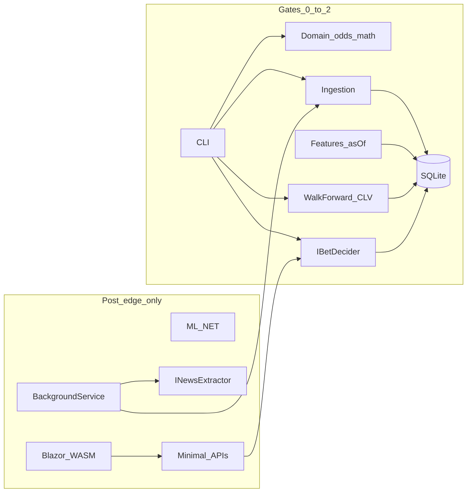

<!-- 34781fc2-103d-4d19-88dc-d39ee616275a -->
---
todos:
  - id: "readme-math-glossary"
    content: "README glossary: ISLP essentials + betting math with definitions (keep in sync with PLAN essentials)"
    status: completed
  - id: "gate0-skeleton-domain"
    content: "Composer: solution skeleton (CLI+Data+Domain only) + odds/EV/Kelly TUnit (-150/+140/-110)"
    status: completed
  - id: "gate0-raw-data"
    content: "Composer: download/commit data/raw (Kaggle/SBRO odds, schedules) with URL/date/license notes"
    status: completed
  - id: "gate0-ingest"
    content: "Composer: CLI import → OddsSnapshots/Games/RefereeAssignments; Donaghy flags; verify row counts"
    status: completed
  - id: "gate1-baseline-clv"
    content: "Composer: market no-vig + Elo walk-forward (no refs); persist BacktestRuns + CLV report"
    status: completed
  - id: "gate1-refs-clv"
    content: "Composer: ref features (crew effects, exclude Donaghy from fit); promote only if OOS CLV beats prior champ; BH on pair mining"
    status: completed
  - id: "gate1-load-clv"
    content: "Composer: B2B/travel/rest + prior-game player minutes/usage features; promote only if OOS CLV beats prior champ"
    status: completed
  - id: "gate1-decider-sweep"
    content: "Composer: IBetDecider + threshold sweep for final wealth; paper ledger CLI; KILL if champ still has no OOS CLV"
    status: completed
  - id: "gate1-openclose-gap"
    content: "Parent: obtain true historical open→close ML covering holdout 2023-24; re-run Gate 1 before paper/live"
    status: pending
  - id: "gate2-live-poll"
    content: "Composer: sharp (+ optional soft) poller; live paper; CLV tracker; CLI advise from manually entered price"
    status: pending
  - id: "gate2b-trust-month"
    content: "Human: ≥1 month live paper with consistent CLV/P&L trust; no real bets until then; reset $1000 if strategy replaced"
    status: pending
  - id: "gate3-real-stakes"
    content: "Human: tiny real bets on DK via manual line entry → app go/no-go; only after gate2b; log entered price + sharp close CLV"
    status: pending
  - id: "post-edge-ml"
    content: "Composer (only if gates pass): logistic→LightGBM; promote only on CLV+P&L"
    status: pending
  - id: "post-edge-news"
    content: "Composer (only if gates pass): INewsExtractor via `claude` CLI subprocess (no Anthropic API SDK); injury-lag alerts"
    status: pending
  - id: "post-edge-ui-azure"
    content: "Composer (only if gates pass): Blazor results UI + Container Apps/Files/Easy Auth"
    status: pending
isProject: false
---
# PossiblyMaybe: find edge → cash it → only then polish

Repo: [`/home/a/source/projects/PossiblyMaybe`](/home/a/source/projects/PossiblyMaybe). Treat empty [`MaybeMoney`](/home/a/source/projects/MaybeMoney) as abandoned; all new code lives here. Methodology book: [`/home/a/Downloads/ISLP_website.pdf`](/home/a/Downloads/ISLP_website.pdf) (ISLP). Prior design in [HANDOFF.md](/home/a/source/projects/PossiblyMaybe/HANDOFF.md).

**Interruptions:** durable state lives in [`PROGRESS.md`](PROGRESS.md). Every parent/Composer session **starts by reading it** and **ends by updating** Snapshot, gate checklist, subagent log, and the YAML todos above. Do not rely on chat history.

**Primary goal: make money.** Everything else (UI, Azure, news LLM, fancy models) is secondary and blocked until an edge is proven.

**Legal posture (not legal advice):** you place bets **manually**; **no DraftKings scrape** and no bet-placement bots. App only advises from prices you type. You still must be of age and allowed to bet in your jurisdiction, follow each book’s terms, and handle taxes — that is on you, not the code.

**Bankroll:** paper (and later real) seed **$1000**. **No real money until Gate 2b:** about **one month** of live paper where P&L and CLV look consistently positive enough that you trust the system. Size up only after that, not after a single green week. If a strategy **fails** a kill gate or is replaced, **reset paper bankroll to $1000** so the next experiment is comparable.

**History window:** prefer **~15 NBA seasons** of clean data when the chosen dataset covers it well; otherwise use what is trustworthy (floor ~10). More history helps Elo/ref stability; junk old odds do not.

**Holdout:** **2023-24** locked (look once). Optional second frozen season (e.g. **2022-23**) allowed for extra trust — score each at most once; do not tune on either.

**MVP (money path):** CLI + SQLite that (1) imports historical open/close **and referee assignments**, (2) walk-forwards market+Elo, then market+Elo+**refs**, (3) reports **CLV vs sharp close** and after-vig P&L, (4) paper-bets live at real timestamps (crew known before bet). Real tiny stakes only after live CLV matches backtest. No Blazor/Azure until that gate passes.

**Secondary:** correctness and auditability of every prediction/bet (append-only ledger). Necessary for trust; not the success metric.

**Refs are first-class inputs** (crews change foul rates, star whistle, game shape). They are not post-edge polish. Famous stories (e.g. Tony Brothers vs Chris Paul) are **hypotheses to test**, never hardcoded rules — promote only on walk-forward CLV.

**End state:** lots of small bets across sports, each sport only after **that** sport passes its own Gates 1–3. NBA is experiment #1 to prove the *lab*, not because it is the easiest market.

**NBA markets:** **Moneyline is primary** (kill gates, champ, trust month, real bets). **Spread is tracked in parallel** (same games, separate predictions/CLV/P&L reports) because the data is there and comparison is cheap — but spread does **not** unlock real money or block ML progress. Prefer advising/betting ML unless spread OOS CLV clearly dominates and you explicitly promote it.

**Multi-sport rule (LLM effort ≠ free):** shared core once; sport packs only after the harness works. Do not stand up five full ingest/feature stacks before any sport shows OOS CLV — that multiplies look-elsewhere luck and slows the first kill gate. Cheap now: `Sport` on games/markets in the schema. Expensive now: five Elo/ref/news pipelines.

## Kill gates (do not skip)

| Gate | Pass when | Fail → |
|---|---|---|
| **0** Data + math | Import has usable open/close; −150/+140/−110 tests green | Fix data/math; no models yet |
| **1a** Baseline | Market + Elo walk-forward has measurable OOS CLV/P&L (holdout locked) | Continue to 1b/1c — refs or load may be the edge |
| **1b** Refs | Same harness + ref features; compare OOS CLV to prior champ | Keep best so far |
| **1c** Schedule / load | Rest, **B2B**, **travel**, short rest, recent **player minutes**/usage (prior games only); compare OOS CLV to prior champ | **Champ = best of 1a/1b/1c.** If champ ≤ close after vig → **stop or change market.** No ML/UI/Azure/news |
| **2** Live equals backtest | Game-day paper fills at logged prices show CLV ≈ backtest (not fantasy fills) | Fix timing/price capture; no real money |
| **2b** Trust month | **≥1 calendar month** of live paper: bankroll trend and CLV look consistently good (not one hot week). Your rule: **no real bets until you trust this.** | Keep paper at $1000 reset rules; fix model/process; do not place real money |
| **3** Cash | Tiny real stakes only after 2b; still check edge after limits/juice | Respect limits; shrink size; do not scale losers |
| **Post-edge** | Only after 1–3 | ML, news-latency alerts, Blazor, Azure |

Promote on **CLV first**, paper/real P&L second, log loss/Brier third. Paper P&L alone never unlocks real money.

**Holdout season:** before any Gate 1 metrics are viewed, pick one full NBA season inside the 10-year window and **freeze it**. All walk-forward tuning uses only the other seasons. When Gate 1 is “done,” score that holdout **once** and record it in `PROGRESS.md`. Looking early or retuning after a peek invalidates the test.

**Sharp close series:** a time-stamped history (and live feed) of **sharp or consensus closing prices** for each game/market — the last efficient number before tip. Every backtest bet and every real/paper ticket stores your price vs that close to compute **CLV**. Without this series, “edge” is unverifiable.

## Persistence (decision)

**SQLite + EF Core.** One file DB. No Postgres/Dapper/DuckDB until backtest I/O hurts.

Append-only: `OddsSnapshots`, `RefereeAssignments`, `Predictions` (model version + inputs hash), `LedgerEntries`, later `NewsItems`. Derived bankroll = sum of ledger.

Azure Files mount is **post-edge only**.

## Target architecture (build in layers)



Solution layout (`PossiblyMaybe.*`) — **Gate 0–2 ship only the bold set:**

- **`Domain`** — American↔decimal, no-vig, EV, Kelly; pure functions
- **`Data`** — EF Core + SQLite, entities, migrations
- **`Ingestion`** — historical CSVs + official assignments; later DK + sharp poller; optional second soft book prices
- **`Features`** — `BuildFeatures(gameId, asOf)` including **ref crew features** when assignment was knowable at `asOf`; shared by train and live
- **`Betting`** — `IBetDecider`: blend → EV @ best available soft price → pass rules → ¼ Kelly → caps; pass if crew unknown when required
- **`Backtest`** — walk-forward only, param sweeps for **final wealth**, CLV vs sharp close; 1a vs 1b comparison
- **`Cli`** — `import`, `backtest`, `report`, `slate`, `paper-bet`, `settle` (add `train` post-edge)
- `Models` — post-edge: logistic/ridge → LightGBM only if beats **ref champ** OOS on CLV
- `News` — post-edge: `INewsExtractor` shells out to **`claude` CLI** (structured JSON on stdout); no Anthropic API SDK/key
- `Api` / `Web` / `Worker` — post-edge: poll, settle, results UI
- `tests/*` — **TUnit** (unit + integration; Playwright e2e only with UI)

## Books and prices

- **Sharp reference:** Pinnacle/consensus for blend weight and **CLV only** — never required as the bet venue.
- **Prove edge (Gates 1–2):** historical + live paper against whatever soft/historical books you have clean open/close for. CLV is always vs sharp close. Winning at Book A does **not** auto-transfer to DK — juice and numbers differ.
- **DraftKings execution (Gate 3+):** **manual price entry**, not a DK scraper. You type the ML/spread/total you can actually bet; app runs `IBetDecider` at **that** price and returns go/no-go + stake. Polled DK odds are optional convenience only; the entered number is source of truth for the decision.
- **Second soft book:** any other retail book where you already have (or can get) an account — FanDuel, BetMGM, Caesars, local, etc. **Not** a paid odds API. You compare numbers in the apps/websites, type the **best** price into `advise`, place manually. Skip entirely until DK’s number is too bad to clear EV.
- **No paid odds API required** for the money path. Historical odds come from free/committed datasets (Kaggle/SBRO-class). Live sharp close for CLV: prefer free/public consensus or manual entry of a sharp/consensus number you can see; do not block the plan on a subscription feed.
- **CLV after bets:** store the entered price, then record sharp close for the same market so tickets still get honest CLV.
- Missing historical juice → assume −110 and **flag** the row.
- No real-money placement bots / IP rotation (ToS). Human places the bet; app only advises.

### Manual advise UX (money path)

```text
slate → pick game/market → enter DK (or other) odds/line → EV @ entered price → pass rules → yes/no + ¼ Kelly stake
```

Same path for paper and real; only the ledger flag changes. Prefer this over automating DK.

## Data (Gate 0)

Commit under `data/raw/` with source URL, download date, license per file.

**Gate 0 concrete data sources = historical sports data only — not news. Locked picks below** (no paid API). One Kaggle file is not enough; use this stack. Gate 0 downloads, notes license/date/URL per file under `data/raw/`, and records row-count QC in `PROGRESS.md`.

| Role | Source | Why |
|---|---|---|
| **A. Games + scores + long odds backbone** | [cviaxmiwnptr/nba-betting-data-october-2007-to-june-2024](https://www.kaggle.com/datasets/cviaxmiwnptr/nba-betting-data-october-2007-to-june-2024) (file spans ~2007–2026, CC0) | Covers ~15y + holdouts; ML + spread + scores. **Caveat:** author notes **ML missing on ESPN-sourced rows since Jan 2023** — do not pretend those ML fields exist. |
| **B. Open/close odds + officials + box (through ~2021–22)** | [visualize25/basketball-betting-dataset](https://www.kaggle.com/datasets/visualize25/basketball-betting-dataset) (`BettingOdds_History`, `Game_Officials`, full game details; SBRO-derived) | True open/close for CLV where available; refs; minutes-capable box tables. Stops before holdouts — merge forward with A/C/D. |
| **C. Recent closing ML/spread (2021–present)** | [caseydurfee/mgm-grand-nba-betting-data](https://www.kaggle.com/datasets/caseydurfee/mgm-grand-nba-betting-data) | Fills **moneyline** through holdouts when A lacks ML. Closing-only → flag rows as close-only CLV (still usable; weaker than open→close). |
| **D. Officials through holdouts** | [sportsdataverse espn_nba_officials](https://github.com/sportsdataverse/sportsdataverse-data/releases/tag/espn_nba_officials) (per-season CSV/parquet, free) | Ref assignments 2002–2026 without a paid API. Prefer over stale Kaggle-only refs for 2022–24. |
| **E. Optional recent open/close consensus** | [minmaxer/nba-closing-lines-ats-2024-25](https://www.kaggle.com/datasets/minmaxer/nba-closing-lines-ats-2024-25) | Nice open/close no-vig for 2024–25 live-paper era; not required for 2023–24 holdout. |

**Import targets**

1. `OddsSnapshots` — merge B (open/close) + A/C (coverage); mark `PriceKind=open|close`, `Book=…`, `ClvQuality=open_close|close_only`. Pinnacle/consensus from B when present; else best available close and **flag**.
2. `Games` — from A (+ B); derive **B2B, rest**; travel when lat/long or arena data available.
3. Player minutes — from B box tables; for seasons after B ends, Gate 0 may one-shot export free `nba_api` / stats box scores into `data/raw/` (still no paid API). Prior games only at `asOf`.
4. `RefereeAssignments` — B historically + **D** through holdouts; Donaghy exclude-from-fit flag.
5. Live (Gate 2): manual price/crew entry; no paid odds API.
6. **News is not Gate 0.**

**Holdout data rule:** 2023–24 (and optional 2022–23) must have scores + usable prices. If ML open→close is incomplete, still run ML where prices exist; report coverage %; use spread series as the parallel tracked market (already secondary). Injury **status** can later override load assumptions; raw news still post-edge.

### Referee feature rules (money + hygiene)

- **Fit vs score:** estimate ref effects only on games used for training folds; never leak same-game whistle into features.
- **Donaghy:** exclude Tim Donaghy assignments from **ref-effect fitting** for the EV/CLV model (esp. 2005–07). Those games may remain for market/Elo labels. Rationale: one confirmed extreme cheater does **not** teach a transferable “small-scale cheat today” detector inside win probs — it biases crew effects. Optional later: use his games only as a **labeled anomaly case study** (which residuals moved) for a separate integrity screen, never mixed into bet sizing. Hunting unproven modern cheaters is not the money path; BH-tested crew effects + CLV are.
- **asOf / live:** ref features are null until the crew is public; decider **passes** (or uses 1a weights) until then. Edge often is “crew posted, soft line not moved yet.”
- **Narratives are tests:** pairs like Brothers–CP3 enter only as candidate features or sliced reports. Keep if walk-forward CLV improves after **Benjamini–Hochberg** (ISLP Ch. 13) across the pair/family tests you tried; otherwise delete. Do not ship lore.
- **Market may already price famous crews.** CLV vs sharp close is the judge — a real on-court effect with no price lag is not a betting edge.

## Models and betting (Gate 1 defaults)

### ISLP essentials (required — small set, not every chapter)

Do **not** port the whole book. Do **use** these ideas whenever the matching work runs. Parent/Composer may not skip them for speed.

**Docs rule:** [`README.md`](README.md) holds the **glossary** (ISLP essentials + betting math + short app terms) with definitions. Any change to this essentials list or to required betting math **must update that README section in the same change**.

| Must use | How it shows up in this app |
|---|---|
| **Bias–variance (Ch. 2)** | Start simple (market → Elo → refs). Add features/models only when OOS CLV improves; prefer the smaller champ on a tie. |
| **Train vs test discipline (Ch. 2/5)** | Features only with `asOf` (no leakage). One **locked holdout season** — look once. Never tune on holdout. |
| **Classification metrics (Ch. 4)** | Report **log loss** and **Brier** on walk-forward slices alongside money metrics (secondary to CLV/P&L). |
| **Resampling / CV done right (Ch. 5)** | **Walk-forward by week/season only.** Ban random K-fold on time-ordered games. |
| **Linear / regularized models (Ch. 4 & 6)** | Post-edge first learned model = **logistic**; try **ridge/lasso** (or equivalent shrinkage) before jumping to trees. |
| **Tree ensembles (Ch. 8)** | **LightGBM** only if it beats regularized logistic **and** the Elo+refs champ on OOS CLV. |
| **Multiple testing (Ch. 13)** | Any ref–player / situational screen uses **Benjamini–Hochberg** (or equivalent FDR control) before a slice becomes a shipped feature. |

Betting-specific math (not ISLP, also required): no-vig, EV, fractional Kelly, CLV vs sharp close.

**Hardware:** **CPU-only is fine.** Elo, ref/load features, logistic/ridge, and LightGBM (ML.NET) do not need a GPU. No local GPU is assumed.

| ISLP idea | When |
|---|---|
| Bias–variance | 1a market+Elo, then add refs; more complexity only if CLV demands it |
| Walk-forward only | Never random K-fold |
| Ref crew features | Gate **1b** (in-scope, not post-edge) |
| B2B / travel / rest / **per-player minutes from previous games** | Gate **1c** (in-scope; rolling load from games **before** `asOf` only) |
| Logistic / ridge → LightGBM | Post-edge, only if they beat the **1a/1b/1c champ** on OOS CLV |
| Multiple testing (BH) | Required for ref–player / ref–team mining |

Betting defaults (sweep for **ending bankroll / CLV**, not bet count): seed **$1000**, `w≈0.2–0.4`, min EV ~2–3%, quarter Kelly, ≤2%/bet, ≤5%/day, drawdown ~−15% peak. Prefer fewer high-CLV spots over betting the whole slate. Paper reset to $1000 when the champ/strategy is replaced after a fail.

## Composer subagent execution

Parent agent: enforce kill gates, merge, refuse post-edge work if Gate 1 failed. **All implementation is offloaded to Composer subagents** (parallel where noted).

### Gate 0 — parallel after empty repo check

| Subagent | Owns | Done when |
|---|---|---|
| **A – Skeleton+Domain** | `PossiblyMaybe.sln`, `Domain`, `Data` (minimal entities/migrations), `Cli` stub, TUnit for −150/+140/−110, EV, Kelly | Tests green; `dotnet build` |
| **B – Raw data** | Download + `data/raw/**` (odds, schedules, **ref assignments**) + NOTES (URL/date/license) | Files present; documented |
| **C – Ingest** (after A+B) | `import` → `OddsSnapshots`/`Games`/`RefereeAssignments`; Donaghy exclude flag; row-count report | Open/close + assignment coverage sanity-checked |

### Gate 1 — sequential (money kill gate)

| Subagent | Owns | Done when |
|---|---|---|
| **D – Baseline 1a** | `Features` asOf guards, market no-vig, Elo, walk-forward, `BacktestRuns`, CLV + after-vig P&L report | 1a metrics written (may be weak) |
| **D2 – Refs 1b** (after D) | Ref crew features (fit excludes Donaghy); optional BH-tested ref–player slices; compare to 1a | Best of 1a/1b so far |
| **D3 – Load 1c** (after D2) | B2B, travel, rest, recent player minutes/usage (`asOf` prior games only); compare OOS CLV | **Champ = best of 1a/1b/1c**; **parent kills if champ ≤ close** |
| **E – Decider+ledger** (after D3 champ exists) | `IBetDecider` (pass if crew required but unknown), wealth sweep, `LedgerEntries`, `paper-bet`/`settle` CLI | Sweep + ledger reconcile |

### Gate 2 — live truth

| Subagent | Owns | Done when |
|---|---|---|
| **F – Live poll+advise** | Sharp (+ optional soft) poller, crew sheet, live paper, CLV tracker, **`advise` CLI: manual odds/line → go/no-go + stake** | Live CLV comparable to backtest; advise path works without DK scrape |

### Gate 3 — human

Tiny real stakes / second soft book. Parent documents outcome; no Composer coding required unless limits force price-source changes.

### Post-edge only (parallel Composer packs; parent unlocks)

| Subagent | Owns |
|---|---|
| **G – ML** | ML.NET logistic → LightGBM on top of ref champ; promote only on CLV+P&L |
| **H – News** | `INewsExtractor` via `claude` CLI subprocess + ~100 labeled eval; pre-bet recheck; injury-lag alert; no API SDK |
| **I – Worker** | `BackgroundService` game-day poll/settle/retrain gate |
| **J – UI+Azure** | Blazor results, Dockerfile, Container Apps + Files + Easy Auth |

### Subagent prompt contract (parent pastes)

Each Composer task gets: repo path, `PLAN.md`, **`PROGRESS.md`**, **allowed project folders**, kill-gate id, todo id, “do not build Blazor/Azure/News/ML unless gate unlocked”, and the single done-when check above. Prefer smallest diff; TUnit for new non-trivial logic.

**Required I/O for progress:**

1. **Start:** read `PROGRESS.md`; set todo to `in_progress`; set gate row to `in_progress` if needed.
2. **During:** if interrupted mid-task, write what landed (paths, commands, partial evidence) into Subagent log + Snapshot `Blocked on` / `Next action`.
3. **End:** set todo `completed` or leave `pending` with failure notes; append log row; refresh Snapshot (`Last updated`, `Current gate`, `Next action`, `Kill status` if Gate 1 died).

## Auth and Azure (post-edge)

Local: no auth. Remote later: one Container Apps process, Easy Auth (Entra, you only), SQLite on Azure Files. News extraction uses **Claude CLI subscription/login**, not API billing — keep that job on a machine where `claude` works (typically local); do not put an Anthropic API key in Key Vault for this.

## Test strategy

- **Gate 0–1:** unit (odds/Kelly/EV, asOf leakage), integration (import→backtest on fixture slice).
- **Gate 2:** poller + settle integration; no Playwright yet.
- **Post-edge:** API/UI e2e if UI ships.

## Explicitly skipped until edge (or forever)

Postgres, Dapper, DuckDB, Hangfire/Quartz until cron hurts, real-money **automation**, IP rotation, Jev/Mercury, Infer.NET/CmdStan, props/OR-Tools, Blazor/Azure/news/boosting **before Gate 1 pass**.

**Not skipped:** referee inputs (Gate 1b); second soft book / line shopping when CLV is thin — money features, not polish.

## Multi-sport strategy

| Do | Don't |
|---|---|
| Prove **process** on one sport (NBA): import → walk-forward CLV → advise → tiny real | Require NBA to be the most profitable sport forever |
| Keep Domain/ledger/backtest/`advise` sport-agnostic | Copy-paste five apps |
| After Gate 2 (or 3) works once, spawn Composer **sport packs** in parallel (NFL, MLB, …), each with its own Gate 1 kill | Merge all sports into one “which won?” leaderboard and pick the lucky one |
| Separate holdouts / BH across sports and feature families | Let a hot month in Sport B “inform” Sport A without a locked test |
| Cross-sport bankroll = many small bets **only on sports that passed** | Spray every slate in every sport to “diversify” before edges exist |

**Does sport A inform sport B?** Infra and discipline yes (CLV, manual DK entry, vig, kill gates). Team strength, refs, and “what works in NBA” mostly no — re-run Gate 1 per sport.

**Confusion check:** one champ per sport, one report per sport, shared ledger with a `Sport` field. That is clear. One mega-model for all sports before any edge is confusing and anti-money.


